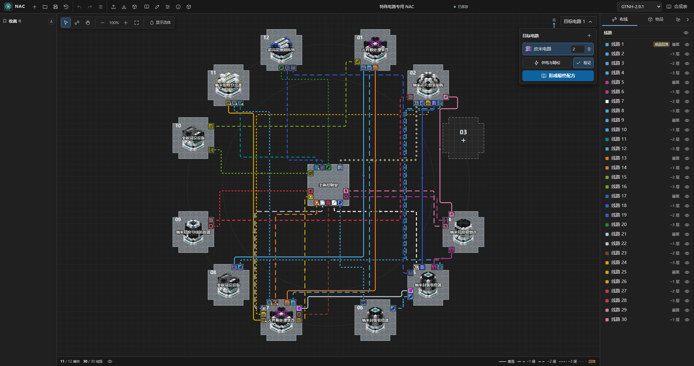
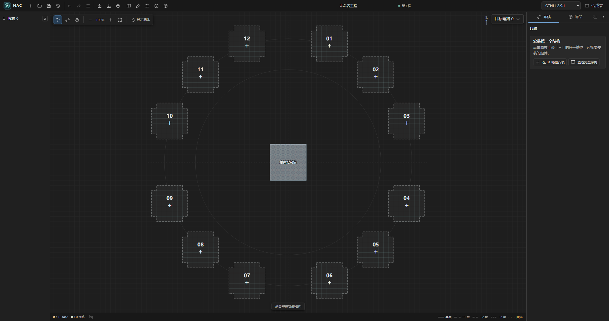
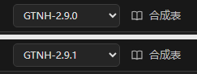

# NAC Route Studio · NAC 路由设计工作室

**NAC Route Studio 1.1** 是面向 **GTNH 2.9.0 和 2.9.1** 的纳米芯片组装复合体（NAC）设计工具。先在画布上安装模块、配置真空传送接口和布线，再匹配配方、核对供电并统计目标电路的耗材。

An offline Windows planner for the **Nanochip Assembly Complex** in **GT New Horizons 2.9.0 and 2.9.1**.

[Windows x64 便携版下载](https://github.com/WarketTian/NACRouteStudio/releases) · [使用说明书 PDF](NAC%20Route%20Studio%201.1%20使用说明书.pdf) · [更新记录](#更新记录) · [English](#english)

*内置「特殊电路专用 NAC」示例（内置一些实例，不过是作者测试之举，愿各员工亲历而为！）。基面为实线，下沉层用不同疏密的虚线表示。*

PS：本软件部分功能由AI实现，但功能都经过测试。

## 下载与启动

1. 从 [GitHub Releases](https://github.com/WarketTian/NACRouteStudio/releases) 下载 **NACRouteStudio-1.1-win-x64.zip**，完整解压到可写入的文件夹。
2. 双击解压目录根部的 **NACRouteStudio.exe**。保留同级的 `app/` 文件夹，程序、内置素材和 Electron 运行文件都随包提供。
3. 在顶栏「合成表」左侧选定 **GTNH-2.9.0** 或 **GTNH-2.9.1**。首次使用默认 2.9.1，工作室会记住上次选择。
4. 在左上角新建工程，或打开已有的 `.nac`。也可以从新手提示里的「查看完整示例」打开一份独立副本。

桌面版可以离线使用。首次启动会在 `%LOCALAPPDATA%\NACRouteStudio\RuntimeCache` 准备运行缓存。便携包中的 `data/` 保存本机设置，默认工程目录是 `data/projects/`。可以在「打开工程 → 选择工程文件夹」中改用自己的目录。

## 快速上手

1. **放置结构。** 点击带「＋」的槽位安装组件。右键组件打开「结构详情」，可查看切片，设置朝向、外壳、净化水等适用参数。
2. **放接口。** 选中组件底板的一格，在侧栏创建真空输入口或输出口。主体控制室里可放原料输入口与成品回收口。设置接口的染色、朝向和物品标记。
3. **开始接线。** 选中接口，点「新建线路」，再点另一端。吸附时会提前显示两端的类型和染色是否匹配。按住 `Ctrl` 点击可加折点，`Backspace` 可撤回本次添加的最后一个折点。默认吸附格心，按住 `Shift` 可自由放置。
4. **指定配方。** 右键加工组件，选「匹配配方」。候选条件包括输入物品标记和同色上游物料。开启「显示流体」后，可在组件外侧查看指定配方用到的流体。
5. **设置目标并验证。** 展开「目标电路」，添加要生产的电路并输入数量。在「供电与精校」里设置电压、输入功率与能量分配，再点「验证」。点问题旁的「定位」，可以在画布上查看对应线路、接口或组件。

新工程的侧栏会随实际操作更新提示，接好第一条线后自动收起。也可先打开内置的**原始、光学或特殊电路**示例，查看完整方案。

## 切换配方版本

合成表、耗材和验证会使用当前版本的配方。工程原有的配方选择随图纸保留。若工程需要当前版本没有的工序，可以切回原版，或在组件里重新指定当前版本的配方。

## 功能

| 功能 | 用法 |
| --- | --- |
| 原版平面布局 | 按 GTNH 2.9.0 的布局绘制主体控制室与周围 12 个槽位，提供模块结构预览和切片。 |
| 多层线路 | 使用基面及三层下沉线路，按线路或图层切换显隐。接口可单独移动，同一组件上的接口也可用 `Ctrl` 多选后整组移动。 |
| 布线整理 | 对比当前图纸与整理预览，两者共享视角。可调整减少同层交叉或重叠、优先基面、减少折弯的权重，也可勾选「同时整理接口」。固定的线路和接口会保留位置。 |
| 配方与物品查询 | 内置 2.9.0 和 2.9.1 两套配方。NEI 风格配方卡支持查制作与用途。物品、配方和目标电路等搜索支持汉字、拼音及首字母，例如用 `pmdl` 查找「皮米电路」。 |
| 供电与精校 | 核对供电等级，查看当前精校对耗时、功率和流体等参数的影响，配置组装矩阵与其他加工模块的功率比例。 |
| 验证与耗材 | 按目标核对线路、材料、加工条件和供电。「形成最终配方」会整理各目标的投料、产出和验证结果。定位可临时显示隐藏的问题线路，退出后恢复原视角和显隐。 |

耗材和供电结果用于设计估算。游戏内的逐刻调度、缓冲存量和随机产出会影响实际运行结果。

## 更新记录

- [v1.1](Updates/v1.1.md) 支持切换 GTNH 2.9.0 和 2.9.1 配方，更新使用说明书。
- [v1.0](Updates/v1.0.md) 首次发布，内置 GTNH 2.9.0 配方。

## 工程保存与恢复

- 打开现有的 `.nac` 后，编辑会自动保存回原文件。按 `Ctrl+S` 可手动保存并创建恢复点。
- 一个 `.nac` 包含图纸、操作历史与恢复点。每个工程最多保留 100 步操作历史，可撤销、重做，也可从「操作历史」跳到指定一步。
- 在「工程备份」中选择恢复点，会生成独立的恢复副本。需要分享工程时，可用「导出工程文件」另存一份可编辑的 `.nac`。
- 旧版 `.nac.json` 可直接打开。文件关联建立后，可双击 `.nac` 打开。若系统出现应用选择框，选择 **NAC Route Studio**。

## 默认快捷键

| 操作 | 快捷键或手势 |
| --- | --- |
| 选择 / 布线 / 平移 | `V` / `R` / `H` |
| 鼠标所在位置缩放 / 适合窗口 | 滚轮 / `F` |
| 打开合成表 / 选目标配方 / 打开物品目录 | `B` / `T` / `I` |
| 收藏物品 | 悬浮物品后按 `A` |
| 添加折点 / 撤回草稿折点 / 自由放置 | `Ctrl` + 点击 / `Backspace` / 按住 `Shift` |
| 撤销 / 重做 | `Ctrl+Z` / `Ctrl+Y` 或 `Ctrl+Shift+Z` |
| 保存与创建恢复点 | `Ctrl+S` |
| 退出定位并返回验证 | `Esc` |

## 反馈与素材来源

提交问题时，请附上软件版本、所选 GTNH 配方版本、操作步骤和相关截图。若问题只在某个工程中出现，也可附上方便公开的 `.nac` 示例。 [GitHub Issues](https://github.com/WarketTian/NACRouteStudio/issues)

- 配方分别对应 GTNH 2.9.0 和 2.9.1。两套配方共用 GTNH 2.9.0 的结构布局、物品和界面纹理。 [GTNH 2.9.0](https://github.com/GTNewHorizons/GT-New-Horizons-Modpack/releases/tag/2.9.0) · [GTNH 2.9.1](https://github.com/GTNewHorizons/GT-New-Horizons-Modpack/releases/tag/2.9.1) · [数据来源与第三方许可](THIRD-PARTY.md)
- 名称、结构与部分精校说明参考中文 Wiki 和 GTNH 社区汉化。IC2 冷却液、UU 物质等图标使用整合包对应版本的素材。 [GTNH 中文 Wiki · NAC](https://gtnh.huijiwiki.com/wiki/NAC) · [GTNH 汉化项目](https://github.com/GTNewHorizons/GTNH-Translations)
- 拼音数据和运行时的许可文件在便携包内。pinyin-data 许可见 `app/editor/src/data/pinyin-data-LICENSE.txt`，Electron 与 Chromium 的许可见 `app/runtime`。

## 许可

NAC Route Studio 的原创代码采用 [PolyForm Noncommercial License 1.0.0](LICENSE)。可按许可条款非商业使用、修改和再分发。商业用途须另行取得授权。

随附的 GTNH 素材、第三方数据和桌面运行时组件适用各自的许可。相关来源和许可见上节。

Required Notice: Copyright (c) 2026 WarketTian

## English

**NAC Route Studio 1.1** is a Windows x64 portable planner for the **Nanochip Assembly Complex** in **GTNH 2.9.0 and 2.9.1**. Lay out modules and vacuum hatches, route materials on four layers, match recipes, and check power and material requirements before building in-game.

The original NAC Route Studio code is licensed under the [PolyForm Noncommercial License 1.0.0](LICENSE). The license permits noncommercial use, modification, and redistribution under its terms. Third-party assets, data, and runtime components retain their respective licenses.

[Windows x64 portable download](https://github.com/WarketTian/NACRouteStudio/releases) · [v1.1 release notes (Chinese)](Updates/v1.1.md)

1. Extract **NACRouteStudio-1.1-win-x64.zip** and run **NACRouteStudio.exe** from the extracted folder. Choose the GTNH recipe version in the toolbar. The default is 2.9.1, and the app remembers your selection.
2. Click a slot marked `+` to add a module, then select a cell to add a hatch. The sidebar guides you through the first connection, and the bundled examples show complete layouts.
3. Create a route from a selected hatch. The preview checks hatch direction and dye compatibility. Use `Ctrl` + click to add bends and `Backspace` to remove the most recent draft bend.
4. Select module recipes, add target circuits and quantities, then configure power and calibration. Run validation and use **Locate** to find an issue on the canvas. Press `Esc` to return to the report and restore the previous view.

Portable projects use the `.nac` format. The file keeps the layout, undo history, and recovery points together. Press `Ctrl+S` to save and create a recovery point. The **Export project file** action creates a shareable, editable copy.
